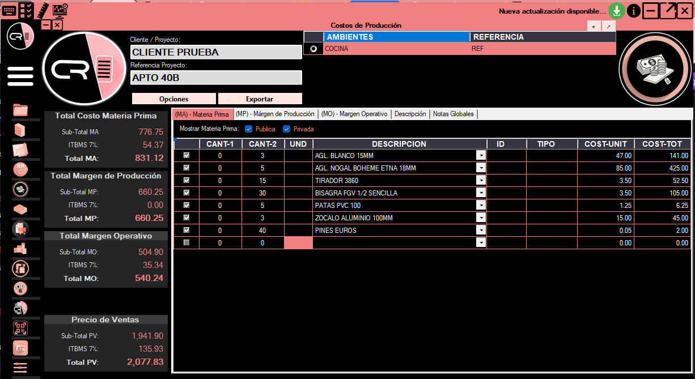

# Costos: guía de la interfaz (`FrmCostos`)

Esta página explica los controles y procedimientos recogidos en las capturas históricas del módulo **Costos**. Para las reglas sobre cliente, proyecto, archivos y ambientes, consulta la [especificación técnica](modulo-costos.md).


**Cómo usar estas páginas:** esta guía describe la **interfaz**. La [especificación normativa](modulo-costos.md) conserva reglas técnicas redactadas previamente. Ninguna de las dos, por sí sola, demuestra que todos esos procedimientos estén implementados en la versión instalada; corresponde contrastarlos con la aplicación.


<figure><figcaption></figcaption></figure>

El módulo de <mark style="color:$primary;">**Costos**</mark> es para gestionar los cálculos económicos de cada ambiente y generar los cuadros de costos y cotizaciones.

## Menú Opciones de Costos


{% column width="33.33333333333333%" %}
Inicia por el menú <mark style="color:$primary;">**Opciones**</mark> el cual tiene las siguientes funciones:


{% column width="66.66666666666667%" %}
<figure><figcaption></figcaption></figure>



* <mark style="color:$primary;">**Cargar reportes de compra XLSX:**</mark> Es para seleccionar y cargar los Reportes de Compras generados por Cabinet Report
* <mark style="color:$primary;">**Cargar archivos de Costos XML:**</mark> Es para seleccionar y cargar los archivos de Costos Generados por Cabinet Report desde el módulo de Costos
* <mark style="color:$primary;">**Agregar archivo Promob PDF:**</mark> Es para seleccionar los PDF de Promob con el contenido de materiales generados a partir del diseño
* <mark style="color:$primary;">**Márgenes:**</mark>
  * Tiene las opciones de Guardar Márgenes o Limpiar Márgenes .png>)
    * <mark style="color:$primary;">Guardar Márgenes:</mark> Es para guardar los archivos (MargenOperativo.xml y MargenProduccion.xml) en la carpeta "ArchivosCliente" ubicada en la misma ruta de la aplicación, los márgenes establecidos para que sean cargados cada vez que se abre la ventana de Costos
    * <mark style="color:$primary;">Limpiar Márgenes:</mark> Es para eliminar los archivos (MargenOperativo.xml y MargenProduccion.xml) de la carpeta "ArchivosCliente" ubicada en la misma ruta de la aplicación
* <mark style="color:$primary;">**Notas Globales:**</mark>
  * Tiene las opciones de Guardar Notas Globales o Limpiar Notas Globales 
    * <mark style="color:$primary;">Guardar Notas Globales:</mark> Es para guardar los archivos (NotasGlobales.xml) en la carpeta "ArchivosCliente" ubicada en la misma ruta de la aplicación, las Notas Globales establecidas para que sean cargadas cada vez que se abre la ventana de Costos
    * <mark style="color:$primary;">Limpiar Notas Globales:</mark> Es para eliminar los archivos (NotasGlobales.xml) de la carpeta "ArchivosCliente" ubicada en la misma ruta de la aplicación
* <mark style="color:$primary;">**Cargar Precios Unitarios:**</mark> Al activar esta opción, la aplicacion debe buscar en la base de datos la Tabla de Aglomerados "TblAglomerados" y la Tabla de Herrajes "TblAccHerrajes" cada item de la lista, tal cual están escritas sin curar texto, para buscar los valores de:&#x20;
  * Para la tabla de Herrajes  "IdAccesorio", "Tipo", "Costo", "Unidad", donde "Descripcion" sea igual a la columna DESCRIPCION del DataGridView de Materia Prima y cargar las columnas de UND, ID, TIPO, COST-UNIT con los valores encontrados.
  * Para la tabla de Aglomerados "IdAglomerado", "PrecioProveedor" donde "Aglomerado" sea igual a la columna DESCRIPCION del DataGridView de Materia Prima y cargar las columnas de ID, COST-UNIT con los valores encontrados, y en las columnas UND, colocar "UND", en la columna TIPO, colocar "Tablero".
* <mark style="color:$primary;">**Limpiar:**</mark> Al hacer clic, debe volver a cargar el formulario en limpio, como si lo volviese a abrir desde el menú de Costos

## De dónde provienen los datos de materia prima

La descripción original de **Cargar Precios Unitarios** relaciona la columna `DESCRIPCION` con dos tablas. El siguiente resumen facilita revisar los campos mencionados, sin asumir que el comportamiento ha sido validado en la versión actual:

| Tabla documentada | Identificador y precio citados | Datos de salida citados |
| --- | --- | --- |
| `TblAccHerrajes` | `IdAccesorio`, `Costo`, `Tipo`, `Unidad` | `ID`, `COST-UNIT`, `TIPO`, `UND` |
| `TblAglomerados` | `IdAglomerado`, `PrecioProveedor` | `ID`, `COST-UNIT`; valores previstos para `UND` y `TIPO` |

Para evitar errores en cotizaciones, verifica que la descripción, unidad y costo correspondan al artículo real, especialmente cuando existan catálogos públicos y privados.

## Mostrar Materia Prima

<mark style="color:$primary;">**Campos de Materia Prima pública y privada:**</mark>

<figure><figcaption></figcaption></figure>

* <mark style="color:$primary;">**Pública:**</mark> al activar este CheckBox, debe filtrar los ComboBox del DataGridView de Materia Prima con solo los Herrajes y Aglomerados que están identificados (Publica) en el campo "Visibilidad" de la tabla de Aglomerados y (Publica) en el campo "Acceso" de la tabla de Herrajes en la base de datos
* <mark style="color:$primary;">**Privada:**</mark> al activar este CheckBox, debe filtrar los ComboBox del DataGridView de Materia Prima con solo los Herrajes y Aglomerados que están identificados (Privada) en el campo "Visibilidad" de la tabla de Aglomerados y (Privada) en el campo "Acceso" de la tabla de Herrajes en la base de datos, pero solo donde el campo "Cliente" de ambas tablas sea igual al cliente indicado en el campo de Cliente de la ventana principal de Cabinet Report (FrmPrincipalCR). Si la opcion privada esta activa, en primera instancia debe cargar los valores de "Costo" y "PrecioProveedor" para el cliente activo en caso de que exista para este cliente.

Siempre debe estar una selección activa, pueden estar ambas activas pero nunca ambas desactivas, y no debe afectar la lista de materia prima establecida actualmente

<mark style="color:$primary;">**Listado de Materia Prima:**</mark>

<figure><figcaption></figcaption></figure>

Después de cargado un archivo de Reporte de Compras debe activar el algoritmo de revisar Descripciones en las tablas de la base de datos.

Pero tambien puede ser llenado manualmente por el usuario:

1. Seleccionar una opción de la lista de la columna DESCRIPCION, tambien puede escribir un valor que no esté en la lista.
2. Al seleccionar una opción de la lista, se debe cargar los valores de UND, ID, TIPO, COST-UNIT después de haber identificado los valores de DESCRIPCION en la base de datos

## Lista de comprobación antes de cotizar

1. Confirmar **cliente**, **ambiente o proyecto** y procedencia de los datos; la [especificación](modulo-costos.md) los distingue en sus apartados 2, 5 y 7.
2. Revisar si se están consultando artículos públicos, privados o de ambas procedencias.
3. Contrastar **DESCRIPCION**, **UND**, **COST-UNIT** y los importes resultantes.
4. Comprobar los márgenes y las notas globales pertinentes antes de generar archivos de salida.
5. Revisar el contenido exportado según las funciones disponibles en la versión instalada.


**Validación pendiente:** esta revisión mejora la lectura del procedimiento histórico, pero no ha ejecutado pruebas en Windows ni contrastado el formulario con el código fuente. No utilices esta página como prueba de implementación.


---

[**Reglas técnicas de Costos →**](modulo-costos.md) · [**Documentación oficial**](https://cabinet-report.gitbook.io/cabinet-report-docs/) · [**Portal Cabinet Report**](https://danielmelendez-pma.github.io/cabinet-report-partners/)
